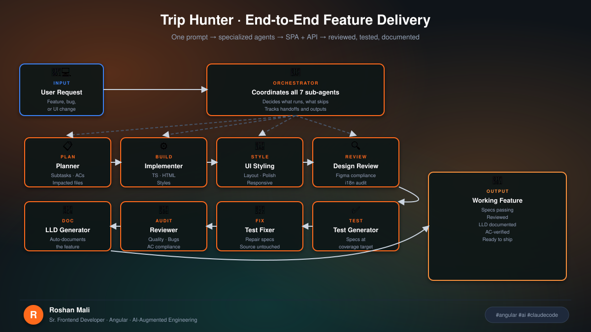
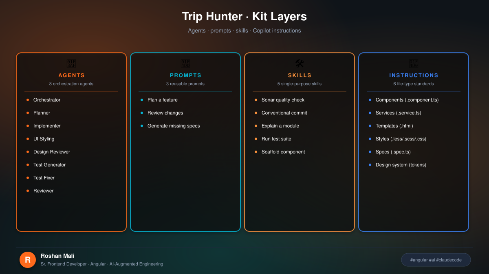
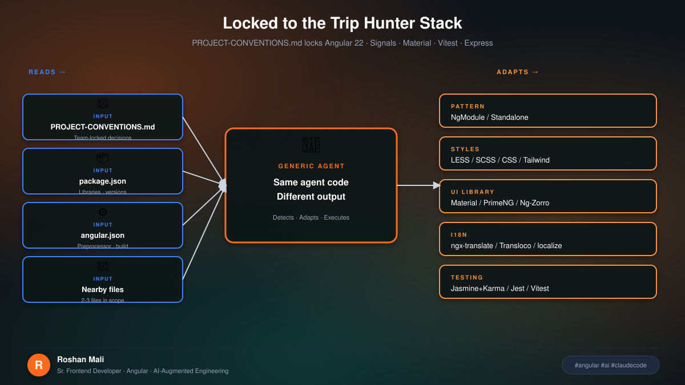
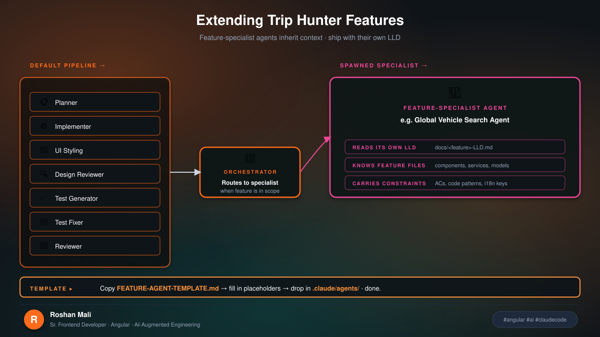

# Trip Hunter Multi-Agent Kit

> Angular Multi-Agent Kit adapted for Trip Hunter — eight coordinated agents for
> plan → implement → style → test → fix → review → document, plus a Buddy India
> specialist. Compatible with **Claude Code** and **GitHub Copilot**. MIT-licensed
> kit files live under this folder and the project agent roots.

[](./LICENSE)
[](https://docs.claude.com/claude-code)
[](https://github.com/features/copilot)
[](https://angular.dev)



---

## Why this exists

Trip Hunter feature work shares a rhythm: plan the SPA + `/api/v1` impact, implement
with standalone Signals, polish glass UI with `--th-*` tokens, generate Vitest specs,
fix failures, review, and document. One giant prompt forgets mid-task.

**Specialization wins.** The kit keeps agents sharp and scoped — planners and reviewers
are read-only; the test fixer only touches specs; styling stays in templates/SCSS.

Based on [angular-multi-agent-kit](https://github.com/RoshanMali1205/angular-multi-agent-kit),
filled in for this application's stack and product rules.

---

## What's in the kit



| Layer | Location | Purpose |
|-------|----------|---------|
| **Agents** | `.claude/agents/` | Orchestration + Buddy specialist |
| **Prompts** | `.claude/prompts/` | One-shot plan / review / generate-specs |
| **Skills** | `.claude/skills/` | Commit, scaffold, explain, run-tests, sonar |
| **Instructions** | `.github/instructions/` | Always-on Copilot standards by file type |
| **Conventions** | `PROJECT-CONVENTIONS.md` | Locked Trip Hunter decisions |
| **Memory** | `.claude/CLAUDE.md` + `.github/copilot-instructions.md` | Claude Code + Copilot entrypoints |
| **Diagrams** | `docs/multi-agent-kit/diagrams/` | SVG pipeline / layers / extend |

---

## Trip Hunter stack (locked)



| Decision | Value |
|----------|-------|
| Angular | 22, **standalone**, Signals + `inject()` |
| Styles | SCSS + `--th-*` tokens (`src/styles/_tokens.scss`) |
| UI | Angular Material + custom glass travel UI |
| Tests | Vitest (`npm test`) |
| i18n | None — English copy in templates |
| API | Express `/api/v1` under `server/` |
| Auth / data | Supabase or demo/memory mode |
| Buddy | Gemini India advisor (`GEMINI_API_KEY`) |

Agents still auto-detect from `package.json` / `angular.json` when conventions are silent.

---

## Extending for complex features



Use `FEATURE-AGENT-TEMPLATE.md` at the repo root to add domain specialists.
Trip Hunter already ships `@buddy-india-advisor` for Buddy / India itineraries.

---

## Quick start

```bash
# Claude Code — end-to-end feature
@angular-orchestrator implement destination photo cards on voting tab

# Single-purpose
@angular-planner plan expense settlement UX improvements
@angular-ui-styling polish explore hero responsive layout
@buddy-india-advisor align buddy-persona with the India playbook

# Copilot
# Open any *.page.ts / *.service.ts — .github/instructions apply automatically
# Project-wide: .github/copilot-instructions.md
```

No npm package install. Kit files are markdown + SVG only.

---

## Folder structure

```text
trip-hunter/
├── PROJECT-CONVENTIONS.md
├── FEATURE-AGENT-TEMPLATE.md
├── AGENTS.md                          ← Cursor Cloud + kit pointer
├── .claude/
│   ├── CLAUDE.md
│   ├── agents/                        ← 8 Angular agents + buddy-india-advisor
│   ├── prompts/
│   └── skills/
├── .github/
│   ├── copilot-instructions.md
│   └── instructions/                  ← file-type standards + design tokens
└── docs/multi-agent-kit/
    ├── README.md                      ← this file
    ├── LICENSE                        ← MIT (kit docs/diagrams)
    └── diagrams/*.svg
```

---

## The pipeline

```text
User request
    │
    ▼
@angular-planner          → subtasks, ACs, SPA + API impact
    ▼
@angular-implementer      → Angular + Express as needed
    ▼
@angular-ui-styling       → templates / SCSS / --th-* tokens
    ▼
@angular-figma-reviewer   → design compliance (if design exists)
    ▼
@angular-unit-test-generator → Vitest specs
    ▼
@angular-test-fixer       → repair failures (specs only)
    ▼
@angular-reviewer         → quality + AC compliance
    ▼
@angular-planner          → docs/<Feature>-LLD.md
```

Buddy / India work: prefer `@buddy-india-advisor` (and the Cursor skill) over the generic pipeline alone.

---

## Optional integrations

- **Work-tracking MCP** (GitHub Issues / Linear / Jira) — planner fetches ACs; reviewer verifies
- **Design MCP** (Figma) — implementer / styling / design reviewer use exact specs

Neither is required. Paste descriptions and screenshots when MCP is unavailable.

---

## License

Kit documentation, diagrams, agent prompts, skills, and instruction files under
`.claude/`, `.github/instructions/`, `PROJECT-CONVENTIONS.md`, `FEATURE-AGENT-TEMPLATE.md`,
and `docs/multi-agent-kit/` are licensed under the **MIT License** — see [LICENSE](./LICENSE).

The Trip Hunter application source remains under the repository's existing license terms.

---

## Author

Adapted for Trip Hunter from **angular-multi-agent-kit** by **Roshan Mali**.
